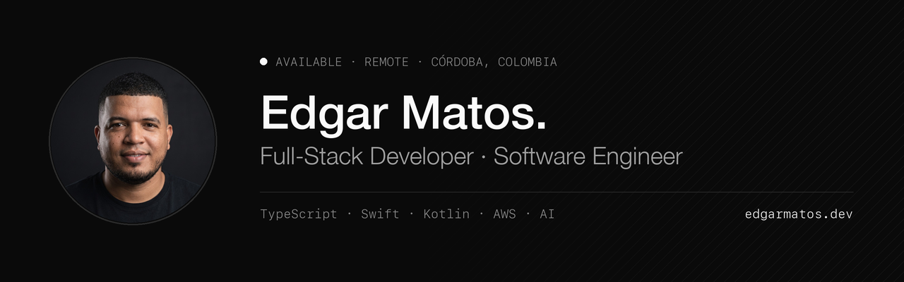

<a href="https://www.edgarmatos.dev/">
  
</a>

<p align="center">
  <a href="https://www.edgarmatos.dev/">edgarmatos.dev</a> &nbsp;·&nbsp;
  <a href="https://www.edgarmatos.dev/cv.pdf">CV</a> &nbsp;·&nbsp;
  <a href="https://www.linkedin.com/in/matosr96/">LinkedIn</a> &nbsp;·&nbsp;
  <a href="mailto:19matos96@gmail.com">19matos96@gmail.com</a>
</p>

<p align="center"><sub>OPEN TO REMOTE WORK &nbsp;·&nbsp; MONTERÍA, COLOMBIA &nbsp;·&nbsp; UTC−5</sub></p>

---

### About

Full-stack developer from the Colombian Caribbean with **4+ years** shipping production software end to end. I cover a product's whole surface: TypeScript APIs, React front ends, native **iOS** (Swift/SwiftUI) and **Android** (Kotlin) apps, and event-driven AWS infrastructure.

Until October 2026 I was the sole engineer at [Orienta](https://www.edgarmatos.dev/work/orienta) — four codebases, one product: iOS, Android, API and backoffice, maintained in parallel. I'm finishing **Software Engineering** at Universidad de Cartagena (9th semester).

Fewer things, done better. Close to the product. Details are the work.

---

### Stack

```text
languages   TypeScript · JavaScript · Swift · Kotlin · Java · SQL
backend     Node.js · Fastify · Express · Spring Boot · REST · JWT
frontend    React · Next.js · Vite · Tailwind CSS · Astro
mobile      SwiftUI · Jetpack Compose · React Native · Flutter
data        MongoDB Atlas · PostgreSQL · MySQL · Room
cloud       AWS (ECS Fargate · SQS · SES · EC2 · S3) · Docker · Vercel
ai          OpenAI · Gemini — provider fallback, hallucination guards
practice    Hexagonal architecture · event-driven design · tests against real services
```

---

### Selected work

**[Plazo](https://www.edgarmatos.dev/work/plazo)** — Android app that warns you before every deadline on any Moodle platform. Live on [Google Play](https://play.google.com/store/apps/details?id=dev.matos.plazo).
<br><sub>Kotlin · Jetpack Compose · Room · Ktor · local exact alarms, no server &nbsp;—&nbsp; source is private</sub>

**[Orienta](https://www.edgarmatos.dev/work/orienta)** — AI vocational guidance platform: psychometric tests, recommendations, continuous university scraping.
<br><sub>TypeScript · Fastify · MongoDB · AWS SQS + Fargate · OpenAI / Gemini · SwiftUI · Kotlin</sub>

**[Aplyra](https://github.com/matosr96/Aplyra)** — ATS-optimised CV generator with an anti-hallucination guard and a similarity cache. 243 tests against real services.
<br><sub>Turborepo · Fastify · MongoDB · hexagonal architecture enforced by ESLint</sub>

**[CleanMyOwn](https://github.com/matosr96/CleanMyOwn)** — Native macOS cleaner. Mach syscalls, Authorization Services, 3-step duplicate detection. No Electron, no telemetry. [Download 1.0](https://github.com/matosr96/CleanMyOwn/releases/tag/v1.0)
<br><sub>Swift 6 · SwiftUI · macOS internals</sub>

Each one is written up as an essay on [my site](https://www.edgarmatos.dev/work): the problem, what I decided, what didn't work.

---

### Experience

```text
2024 — 2026   Orienta               Full-Stack Developer · sole engineer   remote
2024 — 2025   Peta Consulting       Full-Stack Developer                   remote, Chile
2023          Impulsala Marketing   Backend Developer                      freelance
2021 — 2024   Nevobit S.A.S         Front-end → Full-Stack Developer       remote
```

<sub>Full history in the <a href="https://www.edgarmatos.dev/cv.pdf">CV</a>.</sub>
